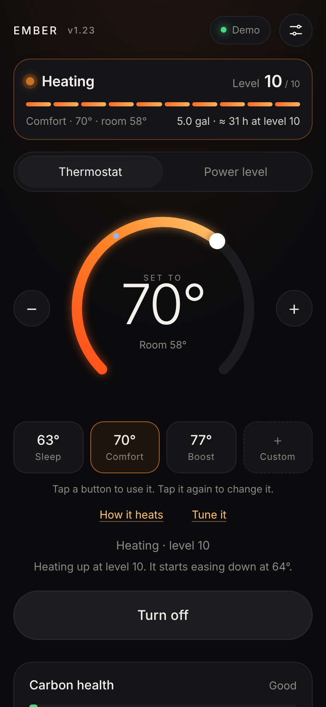
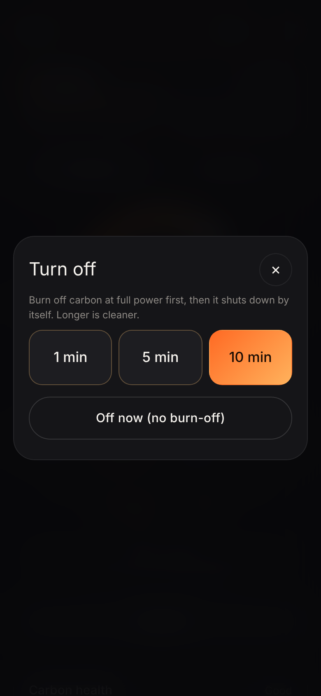
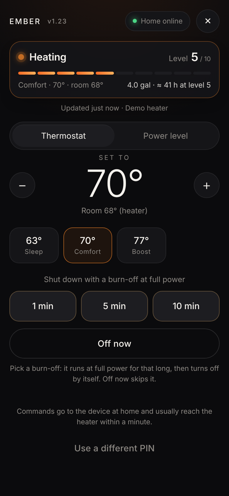
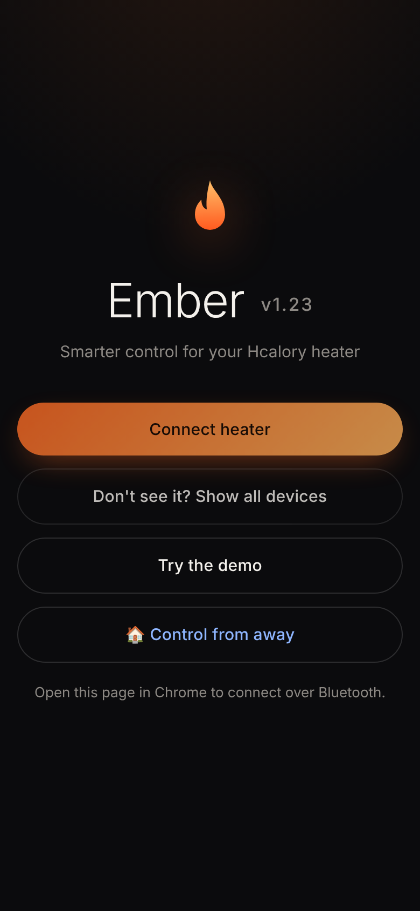
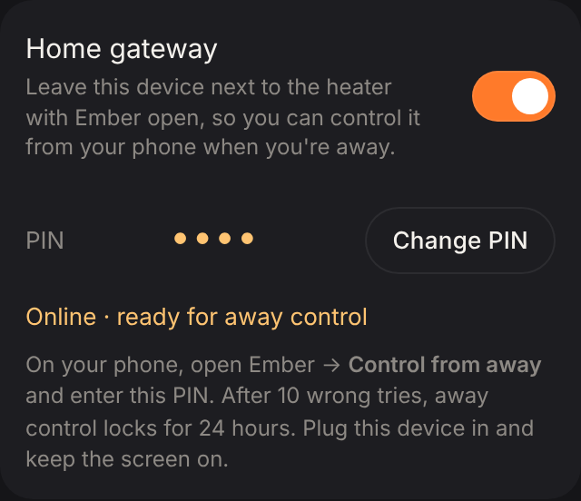
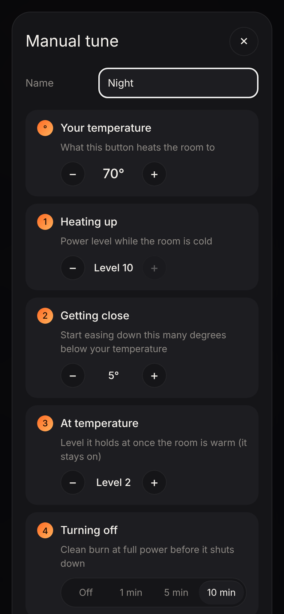
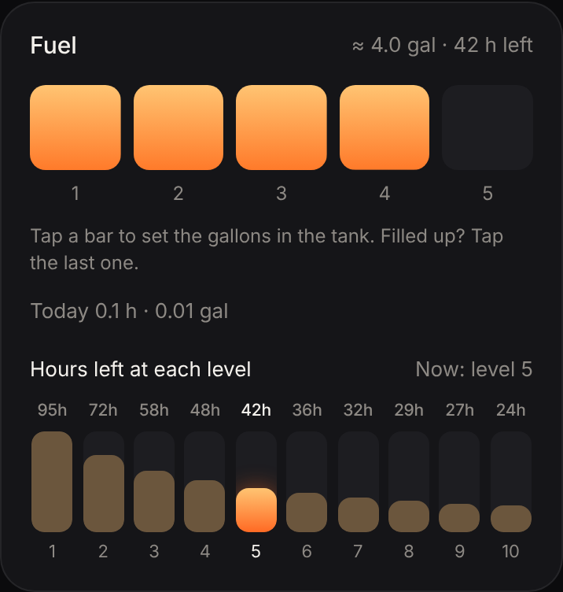
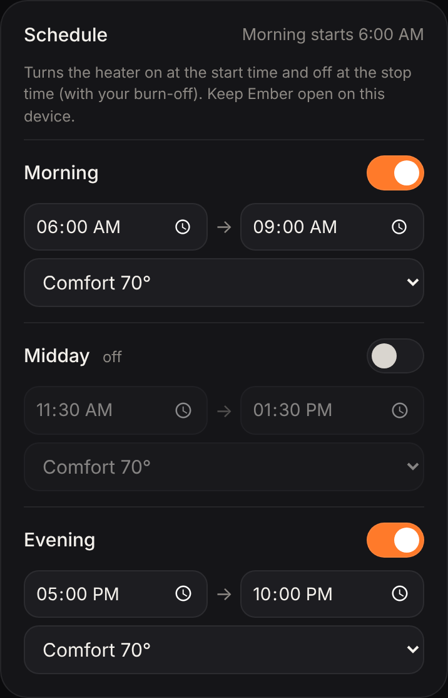

# Ember: a free, smarter app for Hcalory diesel heaters

Ember is an unofficial web app that controls Hcalory Bluetooth diesel heaters from your phone. It was built for and tested on a **Hcalory TB2S**, and should work with other Hcalory Bluetooth heaters.
It isn't made by or affiliated with Hcalory.

**Free · no app store · no developer account · works on Android and iPhone/iPad**

**[⬇ Download the latest version](ember-heater-latest.zip?raw=true)** · [What's new](README.md#versions)

## What it adds

- **Clean shutdown.** When you tap Turn off, you pick a **1, 5 or 10 minute** burn-off at full power (or Off now). It then shuts down, and the heater still does its own safe cool-down.
- **One-dial thermostat.** It runs at full power while the room is cold, eases down as it gets close, then holds at a low level (2 by default) instead of cycling on and off.
- **Three temperature buttons plus one Custom** (Sleep, Comfort, Boost). Tap to use, tap again to change. Each button can have its own power levels and clean-burn length.
- **Status bar** at the top: on/off, current level, the setting it follows, and fuel left.
- **Fuel gauge.** One bar per gallon. Tap a bar to set it, and it shows the hours left at every power level.
- **Govee thermometer as the room gauge** (optional), so it heats to the temperature where you sit.
- **Schedule:** Morning, Midday and Evening windows, each with a start and stop time and which button to use.
- **Extras:** a carbon-health reminder, battery guard and plain-English fault codes.

## What you need

- **A Hcalory heater with Bluetooth app control.** Tested on a TB2S.
- **A phone:**
  - **Android:** use **Chrome**.
  - **iPhone or iPad:** use the free **Bluefy** browser from the App Store. Safari can't do Bluetooth.
- **A free Cloudflare account** to host the app. It takes about 2 minutes, and you don't need a developer account.
- **Optional:** a Govee Wi-Fi thermometer, such as the H5051 or H5179.

## Setup

### 1. Download

Download **[ember-heater-latest.zip](ember-heater-latest.zip?raw=true)**. Don't unzip it.
The version number shows next to the name in the app (e.g. **EMBER v1.23**).

### 2. Put it online (Cloudflare, free)

1. Log in at **dash.cloudflare.com** and go to **Workers & Pages → Create application**.
2. Scroll to the bottom and choose **"Looking to deploy Pages? Get started"**, then **Upload assets**.
3. Name the project (e.g. `ember`) and click **Create project**.
4. Drop in the zip and click **Deploy**.
5. Copy your link, which looks like `https://ember-xxxx.pages.dev`.

**To update later:** open your project, choose **Create deployment**, and drop in the new zip.

### 3. Connect the heater

1. Turn the heater's power on.
2. **Fully close the Hcalory app.** A heater only talks to one app at a time.
3. Open your link in **Chrome** (Android) or **Bluefy** (iPhone).
4. Tap **Connect heater** and pick your heater. Mine shows up as `Heater5082`.
   - If it isn't listed, tap **Show all devices**.
5. Ember unlocks the heater with the factory PIN **0000**. If you changed yours, set it in Settings → Heater PIN.

**Tip:** tap **Try the demo** first to explore the app without a heater.

### 4. Optional: Govee thermometer as the room gauge

**iPhone (Wi-Fi):**
1. In the **Govee Home** app, go to **Profile → ⚙️ Settings → Apply for API Key**. Govee emails you a key.
2. In Ember, go to **Settings → Govee thermometer → Set up**.
3. Paste the key, tap **Find**, then tap your thermometer.

**Android (Bluetooth):** in the same setup screen, choose **Pair over Bluetooth**.

The Wi-Fi option works through the small `_worker.js` file included in the zip. It relays only Govee's two reading requests and stores nothing; your key stays on your phone.

### 5. Optional: control it when you're away

Leave an old phone or iPad next to the heater as the **home gateway**. You can then start it, turn it off, pick a preset or change the temperature from your own phone, anywhere.

**One-time Cloudflare setup (free storage):**
1. In Cloudflare, go to **Storage & Databases → KV → Create**. Name it `ember`.
2. Go to **Workers & Pages → your Ember project → Settings → Bindings → Add → KV namespace**.
3. Set **Variable name** to `EMBER` (all caps) and choose the `ember` namespace. Save it for **Production**.
4. Upload the zip again (**Create deployment**) so the setting takes effect.

**At home (old phone or iPad):**
1. Open Ember and connect the heater.
2. Go to **Settings → Home gateway**, turn it on and **choose a PIN** (4–8 digits).
3. Leave it plugged in, with Ember open, the screen on and Auto-Lock set to Never.

**On your phone:** open Ember → **🏠 Control from away** → enter your PIN.
- **Start:** needs two taps, so it can't start by accident.
- **Thermostat:** pick a temperature or a preset button.
- **Power level:** tap levels 1–10 to set the speed directly.
- **Shut down:** pick a **1, 5 or 10 min** burn-off at full power, and then it turns off.
- **Off now:** turns off right away. It also works during a clean shutdown.
- **Fan only:** runs the blower with no heat and no fuel. Tap the bars to set the fan speed (1–10). Tap the button again to stop it.
- **Updates:** while the away screen is open, the status updates every few seconds and the "Updated … ago" line shows how fresh it is. Commands usually arrive within seconds, and can take up to about a minute.

**Security:**
- **A PIN you choose protects away control.** Only a salted, scrambled (hashed) version of it is stored.
- **10 wrong PINs lock away control for 24 hours**, which makes guessing impractical.
- **Settings → Change PIN** cuts off any phone using the old PIN.
- **Only a short list of commands with sensible values is accepted.** The home device ignores commands older than 15 minutes.

## Quick tour

| | |
| --- | --- |
| **Status bar** (top) | On/off, current level 1–10, the setting it follows, room temperature, fuel left and hours at that level. |
| **Thermostat** | Drag the dial or use −/+. It runs at full power until it's close, eases down, then holds at a low level. Tap **How it heats** for the details. |
| **Buttons** | Sleep, Comfort, Boost and one Custom. Tap to use; tap again to change its temperature, levels and burn-off. |
| **Power level** | Pick a fixed level 1–10 instead of the thermostat. |
| **Turn off** | Choose a 1, 5 or 10 min burn-off at full power, or Off now. |
| **Fan only** | When the heater is off, run just the blower (no heat, no fuel). New in v1.24: if it doesn't work on your heater, send the log. |
| **Fuel** | One bar per gallon. Tap a bar to set it (the last bar means full). Shows hours left at every level. |
| **Schedule** | Turn on Morning, Midday or Evening and set start, stop and which button to use. It turns on at the start time and off (with your burn-off) at the stop time. Overnight windows work too. Keep Ember open on the device by the heater. |
| **Carbon health** | Counts hours on low and suggests a 15-min clean burn when it's due. |
| **Settings** | Room gauge (heater or Govee), units, tank size, battery guard, home gateway, heater PIN, and **Copy log** for help. |

## Good to know

- **Keep the app open and your screen unlocked** during a clean shutdown or a scheduled start. On iPhone, set **Settings → Display & Brightness → Auto-Lock → Never** while you're using the heater.
- **Changing the level on the heater or remote:** Ember sees the change within about 3 seconds. In **Thermostat** mode Ember takes back control within about 45 seconds, so switch to the **Power level** tab if you want to adjust by hand.
- **Govee over Wi-Fi updates every few minutes**, because the thermometer only reports to Govee every few minutes. Bluetooth updates every few seconds.
- **Fuel is an estimate.** The heater doesn't report fuel, so Ember calculates it from the power level. Tap the gallon bars when you refill.

## Troubleshooting

| Problem | Fix |
| --- | --- |
| Heater not in the list | Force-close the Hcalory app, toggle Bluetooth off and on, and try **Show all devices**. In iPhone Settings → Bluefy, make sure **Bluetooth** is on. |
| Heater shows a fault (E-xx) | Tap **Try again** (it clears the fault, then restarts) or **Reset** (clears it and stays off). Both work from away too. After 3 failed tries, check fuel, the fuel line and the exhaust before trying again. For a carbon monoxide fault (E-10/E-11), Ember won't restart the heater. Ventilate and check the exhaust first. If the fault won't clear, switch the heater's main power off for 30 seconds. |
| Connected, but no reply | Settings → **Copy log**, and include it when you ask for help. |
| Didn't reach full power or didn't turn off | Make sure the screen stayed on. Then Settings → **Copy log**. |
| "Missing the Govee relay" | Re-upload the full zip (it includes `_worker.js`). |
| "Cloudflare storage isn't switched on yet" | Do the one-time KV setup in step 5, then upload the zip again. |
| "Too many wrong PINs" | Wait up to 24 hours. The lock clears by itself. |
| Away screen says "Home offline?" | The home device is asleep, closed or out of Wi-Fi. Wake it up and keep Ember open. |
| Govee temperature looks wrong | Settings → **Govee reports in** → switch between °F and °C. |

## Questions

**Will it work with my heater?**
It's built for Hcalory heaters controlled by the Hcalory Bluetooth app. It's tested on a TB2S. It also includes the protocols for older Hcalory and AirHeater-type controllers, but those haven't been tested on a real heater yet. Try the demo, then Connect. If it connects but doesn't respond, send the log from Settings → Copy log.

**Does it change the heater?**
No. It only sends the same kinds of commands the official app sends. The heater's own safety and cool-down still run.

**Does it cost anything?**
No. Cloudflare's free plan covers hosting, the Govee relay and away control for one home.

**Can I still use the remote or the Hcalory app?**
Yes, the remote works alongside Ember. The Hcalory app can't connect while Ember is connected, because the heater talks to one app at a time.

**Is my data private?**
The app runs on your phone and talks to the heater directly over Bluetooth. Your Cloudflare site only relays Govee readings (if you use them) and, for away control, the heater's status and your commands, protected by your PIN.

## Credits

The Bluetooth protocol comes from the community's reverse-engineering work: [homeassistant-diesel-heater](https://github.com/Spettacolo83/homeassistant-diesel-heater), [AirHeater-BLE](https://github.com/mSoftMS/AirHeater-BLE), [hcalory-control](https://github.com/evanfoster/hcalory-control) and [govee-ble](https://pypi.org/project/govee-ble/).

**Use at your own risk.** Diesel heaters burn fuel. Keep a carbon monoxide alarm nearby and follow your heater's manual.
